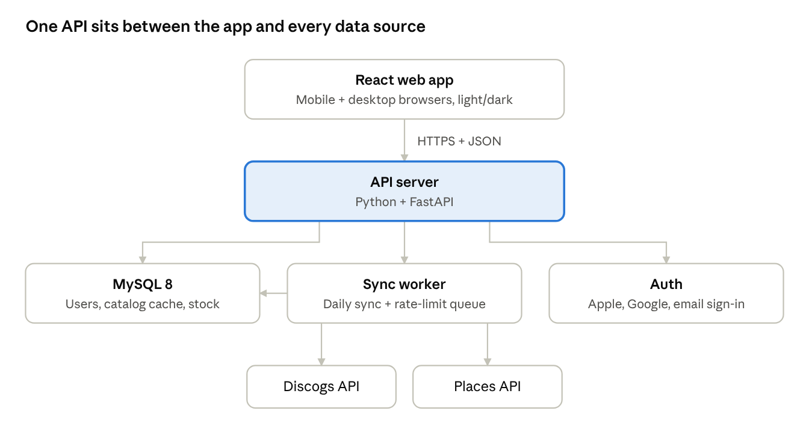

# Binhopper: MVP Spec

As of Oct 22, 2026. Living copy: the Binhopper MVP Spec doc on claude.ai; update this file when it changes.

## Overview

Version 1 helps vinyl collectors find a record they want in a shop near them, then track it in their collection once they have it. It runs as a React web app on desktop and mobile browsers, backed by a Python (FastAPI) API and MySQL.

**Core loop:** search or browse → add to wishlist → see which nearby shops have it (ZIP + 10/25/50/100 mi radius) → locate, hold or buy → add to collection.

**What makes it different:** most vinyl apps catalog a collection. This one answers "where can I get this near me, today?" Online sellers (artist stores, retailer exclusives, Discogs, eBay, Amazon) are a fallback, not the focus.

**Guiding principles**

- A useful free product comes first. No paywalls or ads on core features; monetization is decided after launch.
- Private by default. Profiles, collections and wishlists start as "Only me"; location is used only when needed.
- Honest stock data. Every listing shows how fresh it is, and users can confirm or flag it.
- Open to anyone in the US, but map shops one area at a time and cover each well (Connecticut first), rather than thin coverage everywhere.

**Name:** Binhopper. "Spindle" in the mockups is the old placeholder. Design reference: `design/mockups/` (original light theme plus Night Session dark mode).

## MVP scope

Version 1 ships the core loop plus account settings; everything that depends on heavy usage or extra data sources waits.

| Feature | Release | Why |
| --- | --- | --- |
| Onboarding (ZIP, radius, genres, import offer) | v1 | Gets a user to a useful wishlist in under a minute |
| Search: albums, artists, genre + year | v1 | Entry point to everything |
| Artist page (bio, discography) | v1 | Expected by collectors |
| Album page (tracklist, pressings, listen links) | v1 | Where buying decisions happen |
| Wishlist | v1 | Core loop |
| Nearby stock (ZIP + radius, map + list) | v1 | The differentiator |
| Online sellers fallback | v1 | Covers records no nearby shop has |
| Locate, hold, buy (hand-off to shop) | v1 | Core loop |
| Collection with pressing + condition | v1 | Core loop |
| Discogs import | v1 | Collectors won't start from zero |
| Account settings ("You": 4 tabs mobile, 5 desktop) | v1 | Privacy controls, sign-in and account management |
| Light + dark mode | v1 | Already designed; cheap with theme tokens |
| Empty and error states | v1 | Needed the moment real data is involved |
| Stock confirmation ("I saw it here") | v1 | Part of the launch data plan |
| Two-step sign-in | v1.1 | Optional extra protection once there are real accounts to protect |
| Barcode / cover scan | v1.1 | High value, but needs camera + matching work |
| Price + distance alerts, notifications inbox | v1.1 | Needs reliable stock data first |
| Holds & orders tracking | v1.1 | v1 hands off to the shop's own process |
| Store profiles + follow + new arrivals | v1.1 | Needs shop participation |
| Collection value | v1.2 | Needs marketplace price data |
| Crate-digging route | v1.2 | Builds on alerts + store data |
| Record Store Day mode | v1.2 | Seasonal; time it to an RSD date |
| Sell or trade, shareable profile + gift list | Later | Social features after a user base exists |
| Store portal (inventory upload) | Later | Build when shops ask to be listed |
| Sign in with Apple | Later | Needs a $99/year Apple Developer account; add it with a native iOS app (App Store guideline 4.8) |
| Friends (and the "Friends" privacy option) | Later | Comes with the social features |

## Feature specs

Each v1 feature below lists the rules the build must follow; numbered rules map to the acceptance criteria later in this doc.

### Onboarding

1. Four steps: location, default radius, favorite genres, then import (scanning arrives with barcode scan in v1.1). Back and Continue on every step; the last step offers "Skip for now." It runs once, right after sign-up: a new email account goes there from its confirmation link, a new Google account straight after Google. Signed-out visitors keep using the ZIP box.
2. Location: "Use my location" asks the device for permission and fills in the nearest ZIP; the coordinates are used for that one lookup and never stored. If permission is denied, the screen says location is off and the ZIP entry still works. A 5-digit US ZIP is required to continue.
3. Default radius options: 10, 25, 50, 100 mi. Default is 25.
4. Genres are optional, multi-select, from a fixed list of 12.
5. Choices are saved to the user's settings and can be changed later in You › Settings.

### Search

1. One search box matches artist, album title and label. Results appear after 2+ characters, debounced about 300 ms.
2. A switch picks Albums, Artists or Genre & year. Albums is the default.
3. Filters: In stock nearby, LP, New, Used, Under $30. "In stock nearby" uses the user's current ZIP and radius.
4. Each album result shows title, artist, year, format and a stock line ("3 stores within 25 mi · from $26" or "Nearest copy is 38 mi away").
5. Genre & year: pick a genre, then a decade, then an optional year. Results sort by Most popular or In stock near me.
6. No results → suggest checking spelling and offer browse by genre.

### Artist page

1. Shows photo, genres, origin, a short bio with "Read full bio," and Follow.
2. Discography is grouped Studio / Live / Compilations, oldest first. Each album shows a "N nearby" or "Not nearby" badge.

### Album page

1. Shows cover, title, artist (links to artist page), year, label, genre tags.
2. "Find in stores" shows the count within the user's radius and the lowest price.
3. Tracklist is split by side (A1, A2… B1…) when the catalog provides vinyl positions.
4. Pressings tab lists every vinyl release of the album. Exclusive variants carry a "Retailer exclusive" or "Artist store exclusive" badge.
5. Listen links open the album in Spotify or Apple Music.

### Wishlist

1. Add or remove from any album row or page with the heart. Change is saved immediately. The wishlist belongs to a signed-in account: signed out, the heart asks the user to sign in and saves nothing.
2. An item can target any pressing or a specific one, plus optional max price and minimum condition (Goldmine grades M, NM, VG+, VG, G+, G, P; a sealed "New" copy counts as M).
3. In-stock items show the store count and the nearest store, plus the cheapest when it's a different shop, with a "Find it" button. Out-of-stock items show the nearest copy's distance. Only copies matching the item's pressing, price and condition count.

### Nearby stock

1. Inputs: ZIP and radius (10 / 25 / 50 / 100 mi). Changing either refreshes the map and list.
2. Distance = straight-line from the ZIP's center point to the store, in miles, rounded to one decimal.
3. Only active stores within the radius appear, sorted by stock freshness tier, then distance. Inactive stores also contribute no stock to search, browse, album or artist summaries.
4. Each store shows name, distance, area, quantity, condition, price and a freshness label.
5. Freshness: Discogs-sourced inventory is hidden at six hours since its last successful sync, even if a user verified it more recently. Manual and user-report stock verified in the last 24 h shows "Verified"; otherwise older than 7 days shows "May be out of date" with "Call to confirm." Two missing reports in 24 h show "Reported missing today". Discogs cards link their individual listing with "Data provided by Discogs."
6. Two or more "not on the shelf" reports in 24 h mark the listing "Reported missing" and drop it to the bottom.
7. No stores in radius → show the nearest copy's distance and offer the next radius up and online sellers. Alerts stay hidden until v1.1.
8. Below the store list: "Can't make it? Buy online" with search links for Discogs marketplace, eBay, Amazon and Urban Outfitters. Include the official artist store only when its verified HTTPS URL is configured. No scraped prices or availability claims.
9. Below the stock list, above "Can't make it? Buy online": "Other record shops nearby — no online inventory. Call to check." It lists active shops within the radius that have no Discogs seller account and no listing for this album, sorted by distance, each with name, distance, area, phone (tap to call) and Directions. They never show a price or stock claim, never count toward "N stores have it" or search stock lines, and aren't pinned on the map. When a user reports the album there as on the shelf, the shop moves into the stock list as a user-reported listing under the freshness rules (rule 5).

### Locate, hold, buy

1. Locate: directions in the device's maps app, plus call store.
2. Hold or buy in v1 hands off to the shop: its phone number, website or Discogs listing. In-app holds come in v1.1.
3. After a hand-off, prompt "Got it? Add to collection," which also removes it from the wishlist. The prompt shows on that record's page and on the wishlist until the user answers ("add" or "No thanks"), for up to 7 days; it's remembered in the browser only. The copy is added with its pressing, the listing's price and condition, and the shop as "bought at"; an owned pressing asks before adding a second copy.

### Collection

1. Add from search, album page, wishlist hand-off, or Discogs import.
2. Each copy records pressing, media grade and sleeve grade (M, NM, VG+, VG, G+, G, P), price paid, where bought, notes.
3. Adding a pressing you already own warns "You already own this pressing" and offers "Add as 2nd copy."
4. Views: grid or list; sort by recently added, artist A–Z, genre, year.
5. Estimated value waits for marketplace price data (v1.2). Until then the collection shows records, artists, wishlist and duplicate counts. The collection belongs to a signed-in account.

### Discogs import

1. User connects their Discogs account (OAuth) and picks collection, wantlist, or both.
2. Wantlist items go to the wishlist; collection items keep pressing, condition and notes.
3. Records already in the app are matched by Discogs release ID and skipped. The summary shows added, wishlisted and skipped counts.

### Account settings ("You")

1. Opened from the profile button in the header on every main screen, mobile and desktop.
2. Tabs: Profile, Settings, Privacy, Account (side tabs on desktop). Desktop's Notifications tab arrives with alerts in v1.1.
3. Profile: initials avatar (photo upload comes later), username, favorite genres, connected accounts (Discogs in v1; Spotify and Apple Music listen links need no account).
4. Settings: home ZIP, default radius, current-location toggle (off by default), appearance (Light, Dark, Match system; default Match system).
5. Privacy: profile, collection and wishlist each set to Everyone or Only me (default Only me); a Friends option comes with the social features (Later). Export collection (CSV) and download all data.
6. Account: email, sign-in method, password (reset by email), sign out, delete account with confirmation. Help pages, terms and privacy policy links arrive with the policies before launch.

## Data model

Fifteen tables cover v1 in MySQL 8: the ten below, the album\_genres join table, and four sign-in tables (sessions, auth\_tokens, oauth\_states, rate\_limit\_hits). Catalog data (artists, albums, pressings) is cached from Discogs; users, stores and stock are the app's own.

| Table | Key fields | Relates to |
| --- | --- | --- |
| users | id, username, email, auth\_provider, email\_verified\_at, google\_sub, password\_hash, home\_zip, default\_radius\_mi, theme, created\_at | settings, wishlist\_items, collection\_items |
| user\_settings | user\_id, use\_current\_location, privacy\_profile, privacy\_collection, privacy\_wishlist, favorite\_genres (JSON) | users (1:1) |
| artists | id, discogs\_artist\_id, name, bio, image\_url | albums |
| albums (Discogs "master") | id, discogs\_master\_id, artist\_id, title, year, cover\_url, tracklist (JSON with side positions) | artists, pressings |
| pressings (Discogs "release") | id, discogs\_release\_id, album\_id, label, catalog\_no, barcode, format, variant\_note, exclusive\_to | albums, stock\_listings |
| stores | shop\_key (unique), osm\_id (nullable, unique), active, verified\_at, id, name, address, lat, lng, phone, website, hours, discogs\_seller\_name, source | stock\_listings, stock\_reports |
| stock\_listings | id, store\_id, pressing\_id, price, condition, quantity, source, last\_synced\_at, last\_verified\_at | stores, pressings |
| stock\_reports | id, listing\_id, user\_id, result (present / missing / different\_price), reported\_price, created\_at | stock\_listings, users |
| wishlist\_items | id, user\_id, album\_id, pressing\_id (nullable = any), max\_price, min\_condition, created\_at | users, albums, pressings |
| collection\_items | id, user\_id, pressing\_id, media\_grade, sleeve\_grade, price\_paid, bought\_at, notes, added\_at | users, pressings |
| sessions / auth\_tokens | user\_id, token\_hash, expires\_at (auth\_tokens: purpose, used\_at) | users |

Rules: one user can own the same pressing more than once (copy 2, copy 3). ZIP codes resolve to a lat/lng center through a ZIP lookup table loaded once at setup. Genres and styles sit in album\_genres (album\_id, genre, style), indexed on genre, so genre + year browsing stays fast; artist genres are derived from their albums.

## Data sources

Launch data comes from Discogs (catalog and shop inventory), a places API (shop locations) and user reports; there is no live feed from shops in v1.

| Source | Gives us | How | Limits and rules |
| --- | --- | --- | --- |
| [Discogs API](https://www.discogs.com/developers) | Artists, albums, pressings, tracklists, cover art, exclusive variants | Database endpoints, cached in our tables | 60 requests/min authenticated, 25 unauthenticated; images need auth; check the API Terms of Use before caching |
| Discogs seller inventory | What a shop has for sale, price, condition | `GET /users/{username}/inventory` for each shop's Discogs seller account | Paginated; only "For Sale" items visible; we keep a store → seller-name directory by hand |
| Discogs data dumps | Bulk catalog seed | Monthly CC0 dumps loaded into the database | Free to use; reduces API calls |
| Places API (Google Places or similar) | Shop names, addresses, coordinates, hours | Search "record store" in the area being mapped, review results by hand | Pricing and terms per provider; store only what terms allow |
| User stock reports | "On the shelf" / "missing" / "different price"; "I saw it here" at a shop with no online inventory | Report screen on store and stock pages (signed in) | One report per user per listing per day, and at most 30 reports per user per hour. "Different price" updates manual and user-reported listings, never Discogs listings. "I saw it here" asks for the pressing, new or used, and the sticker price, and becomes a user-reported listing |
| Online sellers | Fallback links | Deep links to a search on the seller's site (artist store, retailer, eBay, Amazon) | No stock data or scraping; affiliate links later |
| Spotify / Apple Music | Listen links | Album search link or ID match | Link out only |

**Refresh rules**

- Shop inventories from Discogs sync about every 4 hours, staggered in the separate worker. All pages must succeed before replacing a snapshot; missing listings get quantity 0. Only for-sale vinyl with known release IDs and USD prices is shown (v1 prices are USD). Unknown releases wait for a CC0 import. Discogs-sourced inventory is hidden at six hours since sync, regardless of user verification; expired prices, quantities and condition are scrubbed by the worker. Manual and user-reported stock keep the 7-day rule.
- A global request queue keeps total Discogs calls under 60 per minute.
- Catalog data comes from the monthly CC0 data dumps; API lookups fill gaps and are refreshed or replaced within 6 hours.
- Freshness labels on listings use `last_verified_at` (user report) first, then `last_synced_at`.

## Tech architecture

A single React app talks to one API; a separate sync worker pulls data from Discogs and the places API so the app never waits on them.

The app only calls our API. The sync worker fills the database on a schedule and through a queue that keeps Discogs calls under its rate limit.

**Stack**

- Front end: React + TypeScript, Vite, React Router, a map library (Mapbox GL or Leaflet), theme tokens for light and dark mode. Responsive layouts from one codebase; a PWA install option for phones.
- Backend: Python 3.12+ with FastAPI, Pydantic models for request and response validation, SQLAlchemy 2.0 as the ORM, Alembic for database migrations. FastAPI's built-in /docs page (Swagger) lets you try every endpoint by hand.
- Database: MySQL 8. Store locations are plain `lat` / `lng` columns with a composite index; the nearby search filters by a bounding box in SQL, then checks exact distance in Python (haversine). This works the same in MySQL and in the SQLite test database. A spatial `POINT` column can replace it later if the store count grows a lot.
- Jobs: a scheduled worker using APScheduler, with python3-discogs-client for Discogs calls.
- Email: Resend for verification and password-reset emails, behind one send\_email interface; local development logs emails instead of sending.
- Hosting: one small app server, a managed MySQL database, and static hosting for the front end.

**Main API endpoints**

| Method | Path | Purpose |
| --- | --- | --- |
| POST | /auth/register, /auth/verify, /auth/sign-in, /auth/sign-out, /auth/forgot-password, /auth/reset-password | Email sign-up and sign-in |
| GET | /auth/google/start, /auth/google/callback | Google sign-in |
| GET | /auth/me | Current user or 401 |
| GET | /zips/nearest?lat=&lng= | Nearest ZIP for "Use my location" (nothing stored) |
| GET | /search?q=&type=albums\|artists | Search catalog |
| GET | /browse?genre=&decade=&year=&sort= | Genre + year results |
| GET | /artists/{id} | Artist page with discography |
| GET | /albums/{id} | Album page, tracklist, pressings |
| GET | /albums/{id}/stock?zip=&radius= | Nearby stores with that album, sorted |
| GET | /albums/{id}/online | Online seller links |
| GET, POST | /stock/{listingId}, /stock/{listingId}/reports | Report screen data; "On the shelf" / "missing" / price report |
| GET, POST | /stores/{storeId}/sighting, /stores/{storeId}/sightings | "I saw it here" at a shop with no online inventory |
| GET, POST, PATCH, DELETE | /me/wishlist | Read, add, change, remove wishlist items (GET /me/wishlist/albums: hearted album ids) |
| GET, POST, PATCH, DELETE | /me/collection | Manage collection copies (POST answers 409 for an owned pressing unless `another_copy`; GET /me/collection/owned?album_id= for the album page) |
| POST | /me/import/discogs | Start a Discogs import |
| GET | /listings/{id} | One copy at one shop, for the hold-or-buy page |
| POST | /me/collection/from-listing | "Got it? Add to collection" (adds the copy, removes the album from the wishlist) |
| GET, PATCH | /me/settings | ZIP, radius, theme, privacy, genres |
| GET | /me/export, /me/data | Collection CSV; all your data as JSON |
| DELETE | /me | Delete account and all data |

## Privacy, security and compliance

Everything a user stores starts private, and the app collects only what the core loop needs.

- **Private by default:** profile, collection and wishlist are "Only me" until the user changes them. What someone paid and their collection's value are never shown to others.
- **Location:** device location is off by default and requested only when the user taps "Use my location." The server stores the home ZIP, not GPS history.
- **Account deletion in the app:** a privacy feature: anyone can delete their account from You › Account. Deleting removes the user row and all wishlist, collection, report, session and settings data. Anonymized stock reports may be kept for listing accuracy.
- **Data export:** collection as CSV, plus a full data download.
- **Sign-in:** Google or email + password in v1; Sign in with Apple waits for a native iOS app, and optional two-step sign-in comes in v1.1. Email sign-ups confirm their address by a link before the first sign-in. Passwords are hashed with Argon2id. Sessions use an HttpOnly, SameSite=Lax cookie set through the app's own origin; sign-in, sign-up and reset are rate-limited, and responses never reveal whether an email has an account. Verification and password-reset emails are sent through Resend.
- **Connected accounts:** Discogs, Spotify and Apple Music use OAuth; tokens are encrypted at rest and removed on disconnect.
- **Transport and secrets:** HTTPS everywhere; API keys only on the server, never in the React bundle.
- **Abuse limits:** rate-limit stock reports per user, and search per IP address (search works signed out), to protect data quality and the Discogs quota.
- **Policies before launch:** a privacy policy and terms of use, linked in You › Account.

## Acceptance criteria and test plan

The riskiest logic is the radius math, stock freshness and duplicate handling, so those get the most tests; each criterion below is written to become an automated test.

| ID | Feature | Given / When / Then | Test level |
| --- | --- | --- | --- |
| AC-01 | Nearby stock | Given ZIP 10011 and radius 25, when stock loads, then only stores ≤ 25.0 mi appear, closest first within each freshness tier | Unit + API |
| AC-02 | Nearby stock | Given a store at exactly 25.0 mi, when radius is 25, then it is included | Unit |
| AC-03 | Nearby stock | Given no stores within 10 mi, when radius is 10, then the empty state shows the nearest copy's distance and a "Try 25 mi" action | E2E |
| AC-04 | Nearby stock | Given an invalid ZIP (e.g. 4 digits or unknown), when submitted, then an inline error shows and no request is sent | Unit + E2E |
| AC-05 | Freshness | Given a listing last synced 8 days ago and never verified, when shown, then it carries the "May be out of date" warning | Unit |
| AC-06 | Freshness | Given 2 "missing" reports in 24 h, when the list loads, then that listing shows "Reported missing" and sorts last | Unit + API |
| AC-07 | Stock reports | Given a user already reported a listing today, when they report again, then the API returns 429 and the UI says they already reported | API |
| AC-08 | Wishlist | Given an album, when the heart is tapped twice, then it is added then removed, and a reload shows the final state | E2E |
| AC-09 | Collection | Given a user owns pressing X, when they add X again, then the duplicate warning shows and "Add as 2nd copy" creates copy 2 | Unit + E2E |
| AC-10 | Hand-off | Given an item bought through a store hand-off, when "Add to collection" is confirmed, then it leaves the wishlist and appears in the collection | E2E |
| AC-11 | Discogs import | Given 3 releases already in the collection, when importing a Discogs collection containing them, then the summary counts them as skipped and no duplicates are created | API |
| AC-12 | Search | Given 1 character typed, then no request is sent; given 2+, then results load once typing pauses | Unit |
| AC-13 | Privacy | Given a new account, then profile, collection and wishlist are all "Only me" and another user's request for them returns 404 | API |
| AC-14 | Settings | Given appearance "Match system" and a phone in dark mode, when the app opens, then the dark theme shows | E2E |
| AC-15 | Account | Given a confirmed delete, then the user's data is gone and sign-in with the old credentials fails | API + E2E |
| AC-16 | Rate limit | Given 100 sync jobs queued, when the worker runs, then Discogs calls never exceed 60 in any 60-second window | Integration |
| AC-17 | Nearby stock | Given an active shop with no Discogs seller 12 mi from the ZIP and radius 25, when stock loads, then it appears under "Other record shops nearby" with call and directions, without a price, sorted by distance, and is not counted in the stock list | API + Unit + E2E |
| AC-18 | Stock reports | Given a shop listed under "Other record shops nearby", when a signed-in user reports the album there as on the shelf, then the shop moves into the stock list as a user report labelled "Verified" for 24 h, then under the 7-day rule | API + E2E |
| AC-19 | Account | Given a new email sign-up, when the emailed link is opened, then the account is verified and signed in; the same link fails a second time, and a link older than 24 h fails | API + E2E |
| AC-20 | Account | Given an unknown email or a wrong password, then sign-in, sign-up, forgot-password and resend-verification respond identically (same status and body) | API |
| AC-21 | Account | Given a password reset, then all the user's other sessions end and the reset link works once, within 1 h | API + E2E |

**Test approach**

- Unit: distance and radius math, freshness rules, duplicate detection, ZIP validation (pytest; Vitest for React).
- API: every endpoint's happy path, auth, privacy and error codes, against a seeded test database.
- End-to-end: Playwright on mobile (390 px) and desktop (1440 px) widths, light and dark themes, covering the core loop: search → wishlist → nearby → hand-off → collection.
- Discogs and Places are mocked in all automated tests; one nightly smoke test hits the real Discogs API.
- Accessibility: automated checks (axe) in the Playwright run; 44 px touch targets and 4.5:1 text contrast, as in the mockups.
- CI: lint, unit and API tests, frontend build, and E2E (Playwright at 390 px and 1440 px, API mocked) on every pull request and on pushes to develop, staging and main.

## Open decisions and next steps

All launch decisions are made (details and sources in `docs/decisions/launch.md`); only the custom domain and USPTO search wait until before the public launch.

**Open decisions**

- [ ] Backend language: decided, Python (FastAPI) with MySQL 8
- [x] Coverage: available US-wide; shop mapping starts in Connecticut (central ZIP 06037, Berlin) and expands region by region, New York next
- [ ] Name: decided, Binhopper. Development stays local; hosting will use the default Vercel and Railway addresses. Pick a custom domain (binhopper.com is taken) and run a USPTO search before the public launch
- [x] Places provider: none at launch. Shops are hand-mapped from OpenStreetMap and Foursquare Open Source Places and stored as manual; Google Places rules out non-Google maps and permanent storage
- [x] Discogs terms: API content may not be shown more than 6 hours behind Discogs; catalog comes from the CC0 monthly dumps; shop inventory is restricted data; cover images are shown from Discogs' URLs, not re-hosted; show both required notices (see `docs/decisions/launch.md`)

**Next steps**

1. Settle the decisions above.
2. Map 20–40 record shops in Connecticut and find which sell on Discogs.
3. Show the clickable mockups to about 5 collectors and note where they hesitate.
4. Set up the repo: React front end, chosen backend, MySQL 8, CI running the tests above.
5. Build in this order: catalog import and search → album page → nearby stock → wishlist → collection → account settings → Discogs import.
6. Private beta with a handful of Connecticut collectors, then launch US-wide with Connecticut shops mapped.
